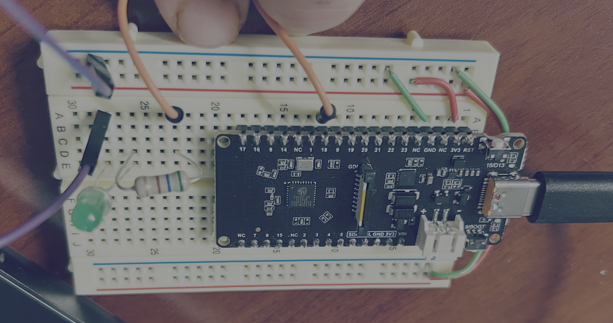
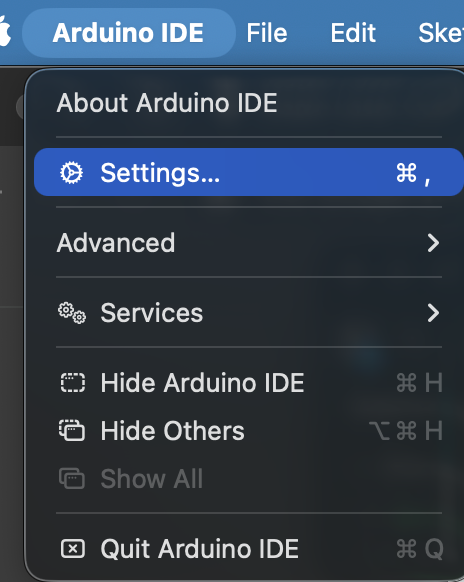
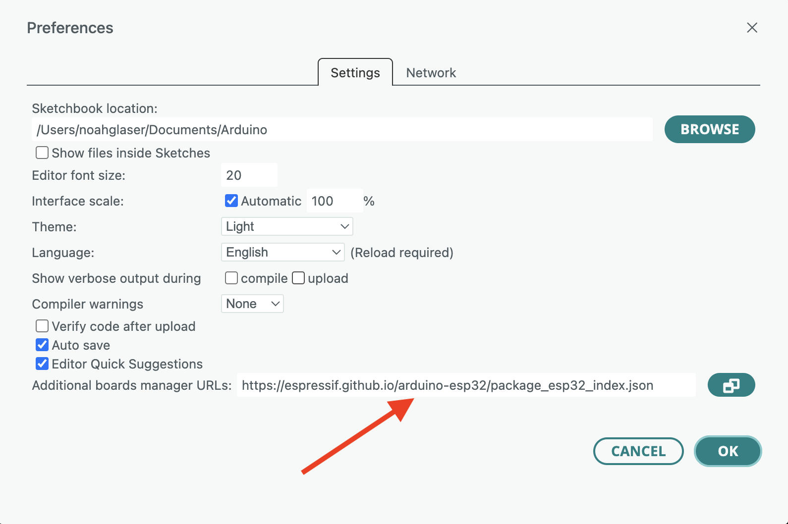
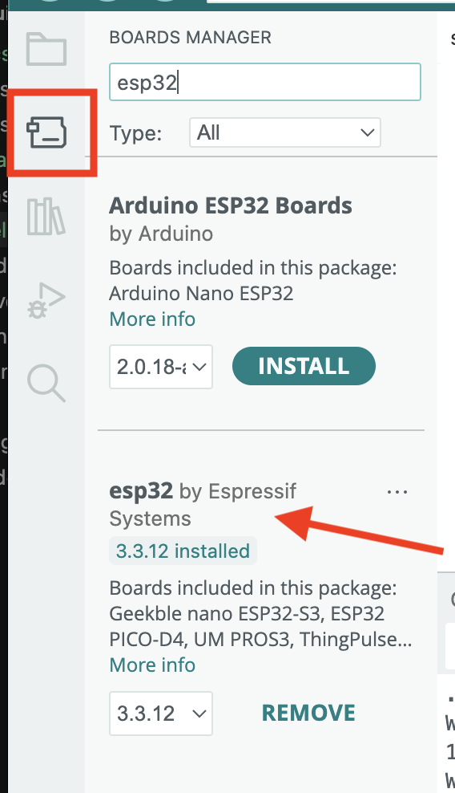
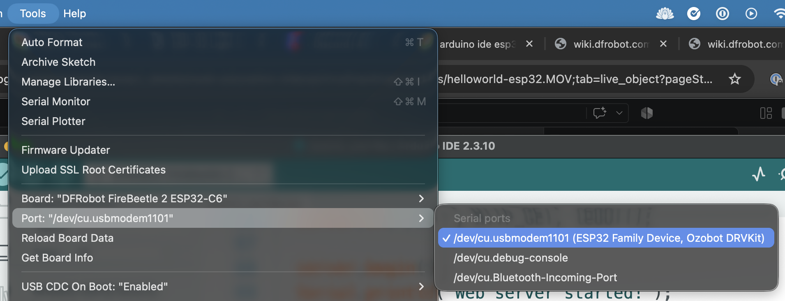
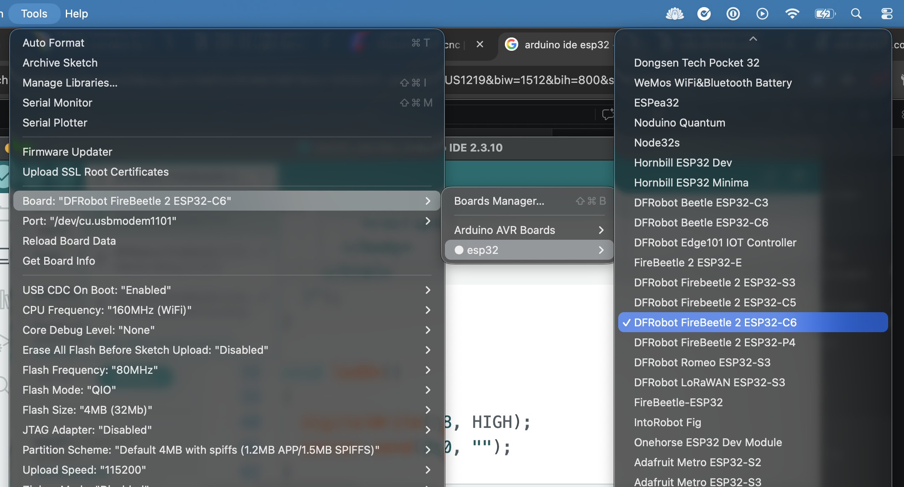
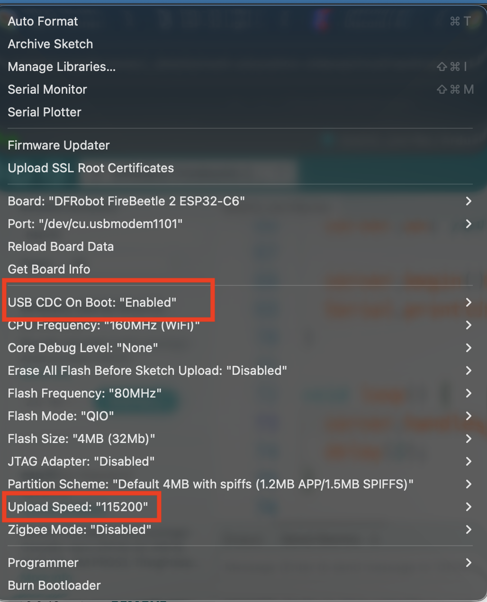
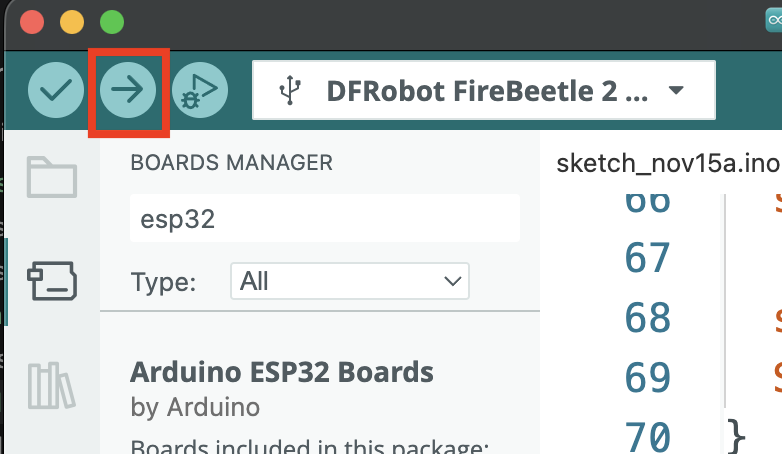
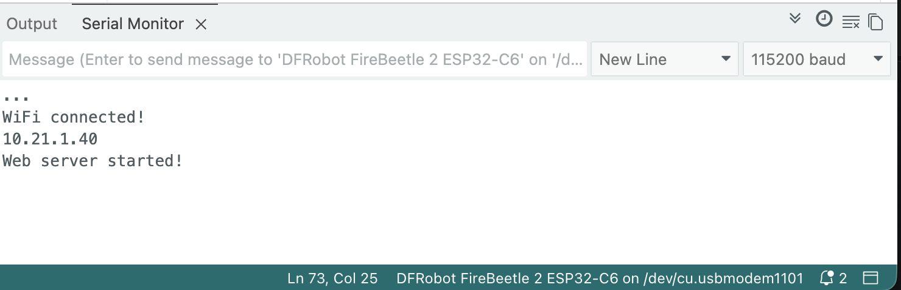

# Hello World ESP-32

We'll use the ESP-32 to build a simple web server that can turn on and off and LED.  You will be able to go to a webpage and turn led on and off.

## Project Demo

<video controls src="https://storage.googleapis.com/noah-education-videos/circuithackingmondays/helloworld-esp32.MOV" ></video>


## Components

* ESP-32
* LED 
* Resistor

## Wiring

| Component | Pin | Connection |
|---|---|---|
| LED | Anode (+, long leg) | GPIO 18 through a 220Ω resistor |
| LED | Cathode (-, short leg) | GND |



## Arduino Setup

Go to Arduino - (Preferences or Setting).  You will see a place for additional boards.  Paste in this url.

```bash
https://espressif.github.io/arduino-esp32/package_esp32_index.json
```






Click on the board icon and type in esp32.  You should see a option for espressif.  Install that board.




Then go to Tools -> Ports and select the right port.  For the mac you will see /dev/cu.usbmodem1101 for windows you will see a COM3 or COM (Some number option).




Then go to Tools -> Boards and select "DFRobot Firebeetle 2 ESP32-C6"




Then make sure these are selected in the Tools:
The important ones are the upload speed is 115200 and the USB CDC ON Boot is enabled.




Upload this code you will press the right arrow button.  If the LED is blinking you wired everything correctly.




```ccp
void setup() {
  // put your setup code here, to run once:
  pinMode(18, OUTPUT);
}

void loop() {
  // put your main code here, to run repeatedly:
  digitalWrite(18, HIGH);
  delay(1000);
  digitalWrite(18, LOW);
  delay(1000);
}
```

## Coding the server

Upload this code.

```ccp
#include <WiFi.h>
#include <WebServer.h>

const char* ssid = "Noisebridge";
const char* password = "noisebridge";

WebServer server(80);

void handleHome() {
  server.send(200, "text/html", R"(
    <!DOCTYPE html>
    <html>
      <head>
        <title>ESP32 Web Server</title>
      </head>
      <body>
        <h1>Hello from ESP32!</h1>
        <p>Welcome to my website.</p>
      </body>
    </html>
  )");
}

void setup() {
  Serial.begin(115200);

  WiFi.mode(WIFI_STA);
  WiFi.begin(ssid, password);

  while (WiFi.status() != WL_CONNECTED) {
    delay(500);
    Serial.print(".");
  }

  Serial.println("\nWiFi connected!");
  Serial.println(WiFi.localIP());

  server.on("/", HTTP_GET, handleHome);

  server.begin();
  Serial.println("Web server started!");
}

void loop() {
  server.handleClient();
  delay(2);
}
```

Go to your Serial Monitor and see the ip address of your esp32.  If you don't see serial monitor go to Tools -> Serial Monitor.  Mine in the picture is 10.21.1.40.



Then open up a broswer and go to http://{ip addreess printed}.


Once you have uploaded this code your ready upload the server code.  I am happy to go over the code with you and explain exactly how it works.  Please ask!

## Upload Server Code

```ccp

#include <WiFi.h>
#include <WebServer.h>

const char* ssid = "Noisebridge";
const char* password = "noisebridge";

WebServer server(80);

void handleHome() {
  server.send(200, "text/html", R"(
    <!DOCTYPE html>
    <html>
      <head>
        <title>ESP-32 Light Server!!</title>
      </head>
      <body>
        <h1>ESP-32 Light Server!!</h1>
        <p>LED: OFF</p>
        <button id='on'>On</button>
        <button id='off'>Off</button>
        <script>
          const p = document.querySelector('p');
          document.querySelector('#on').addEventListener('click', async () => {
            await fetch('/on');
            p.textContent = 'LED: ON';
          });
          document.querySelector('#off').addEventListener('click', async () => {
            await fetch('/off');
            p.textContent = 'LED: OFF';
          });
        </script>
      </body>
    </html>
  )");
}

void ledOn()
{
  digitalWrite(18, HIGH);
  server.send(200, "");
}

void ledOff()
{
  digitalWrite(18, LOW);
  server.send(200, "");
}

void setup() {
  Serial.begin(115200);
  pinMode(18, OUTPUT);
  WiFi.mode(WIFI_STA);
  WiFi.begin(ssid, password);

  while (WiFi.status() != WL_CONNECTED) {
    delay(500);
    Serial.print(".");
  }

  Serial.println("\nWiFi connected!");
  Serial.println(WiFi.localIP());

  server.on("/", HTTP_GET, handleHome);
  server.on("/on", HTTP_GET, ledOn);
  server.on("/off", HTTP_GET, ledOff);

  server.begin();
  Serial.println("Web server started!");
}

void loop() {
  server.handleClient();
  delay(2);
}

```

## Challenge

Create a button on the webpage to make it the led blink.